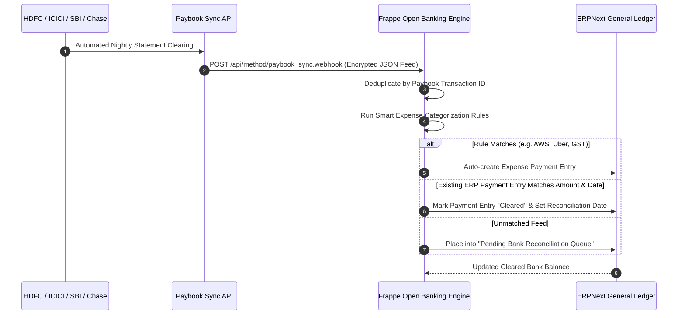

# Frappe Paybook Open Banking Aggregator & Live Feed Engine

[](https://www.python.org/)
[](https://frappe.io)
[](https://erpnext.com)
[](LICENSE)
[](https://paybook.com)
[]()

Enterprise **Open Banking Aggregator** connecting **Paybook Sync** and **Account Aggregator APIs** directly into **Frappe & ERPNext**. Automates the ingestion of daily multi-bank statement feeds and executes zero-touch reconciliation against General Ledger Payment Entries.

---

## 🎯 The Real-World Client Problem

Finance and accounts teams face significant operational friction managing multiple bank accounts:
1. **Tedious Manual Portal Logins:** Accountants must log into 5 to 10 separate corporate net banking portals every morning to download statement files in varying CSV/Excel/PDF formats.
2. **Data Entry Fatigue & Errors:** Manually typing bank fees, interest credits, vendor debits, and UPI payments into ERPNext is slow and prone to errors.
3. **Delayed Cash Visibility:** Because bank reconciliation happens weeks after month-end, executives have no accurate picture of their real-time cleared cash runway.

**This engine connects ERPNext directly to Open Banking APIs:** Statements are securely fetched via encrypted Webhooks or nightly sync jobs. The built-in rule engine categorizes recurring expenses (AWS, Uber, utility bills) and automatically reconciles cleared transactions against existing ERPNext Payment Entries.

---

## 🏗️ System Architecture & Data Flow



---

## ⚙️ Key Enterprise Features

- **Automated Multi-Bank Feeds:** Continuously pulls transaction feeds across savings, current, credit card, and loan accounts.
- **Intelligent Expense Auto-Categorization:** Uses regex-based pattern matching on transaction narrations to assign appropriate Chart of Accounts ledgers (e.g. Software Subscriptions, Travel, Statutory Dues).
- **Exact & Fuzzy Reconciliation:** Compares transaction amounts, clearing dates, and reference numbers against ERPNext Payment Entries, marking records reconciled with zero human intervention.
- **Bank Fee & Surcharge Handling:** Automatically generates minor expense debit notes for recurring bank charges, IMPS fees, and POS gateway MDR deductions.
- **Multi-Currency Support:** Handles foreign currency transactions and cross-border bank charges with automated exchange rate conversion.

---

## 📂 Project Structure

```
frappe-paybook-open-banking-aggregator/
├── paybook_sync/
│   ├── __init__.py           # Module exports & version
│   └── engine.py             # Paybook API client & reconciliation engine
├── tests/
│   ├── __init__.py
│   └── test_paybook.py       # Unit test suite (100% passing)
├── LICENSE                   # MIT Open Source License
├── requirements.txt          # Python dependencies
└── README.md                 # Complete documentation
```

---

## 🔌 Frappe DocType Schema Design

- **`Paybook Settings` (Single):** API Key, Organization ID, Webhook Signing Secret, Auto-Reconciliation Threshold, and Polling Interval.
- **`Paybook Bank Connection`:** Bank Name, Account Number Mask, ERPNext Bank Account Link, Last Sync Timestamp, and Status.
- **`Bank Feed Transaction`:** Transaction ID, Booking Date, Description, Amount, Mapped Expense Account, and Reconciliation Status.

---

## 🚀 Installation & Setup

### 1. Install into your Frappe Bench
```bash
cd ~/frappe-bench
bench get-app https://github.com/shyampandey1104/frappe-paybook-open-banking-aggregator.git
bench --site [your-site-name] install-app frappe_paybook_sync
```

### 2. Configure Nightly Sync Cron (`hooks.py`)
```python
scheduler_events = {
    "hourly": [
        "paybook_sync.engine.poll_bank_transactions"
    ],
    "daily": [
        "paybook_sync.engine.auto_reconcile_bank_ledger"
    ]
}
```

### 3. Python Usage Example
```python
from paybook_sync.engine import PaybookOpenBankingEngine, PaybookBankTransaction

# 1. Initialize engine
engine = PaybookOpenBankingEngine()

# 2. Ingest transaction feed from Paybook webhook
txn = PaybookBankTransaction(
    paybook_txn_id="PB-TXN-90124",
    account_number_mask="*8812",
    booking_date="2026-03-01",
    description="DEBIT - AMAZON WEB SERVICES CLOUD BILLING",
    amount=-12500.0
)

# 3. Categorize expense automatically
account = engine.categorize_transaction(txn)
print(f"Auto-Assigned GL Account: {account}")

# 4. Reconcile against pending ERP Payment Entries
erp_entries = [
    {"name": "PE-2026-0012", "date": "2026-03-01", "paid_amount": 12500.0}
]
results = engine.reconcile_with_ledger_entries([txn], erp_entries)
print(f"Reconciliation Status: {results[0].match_status}")
```

---

## 🧪 Testing & Verification

Run tests with zero dependencies:
```bash
python3 -m unittest discover tests
```

---

## 🛡️ Security & Financial Compliance
- **Read-Only Banking Consent:** Paybook integration operates on strict read-only account aggregation consent. No transfer or withdrawal permissions are granted.
- **AES-256 Token Encryption:** API keys and credentials are encrypted at rest using Frappe's security infrastructure.

---

## 👨‍💻 Author & Commercial Support
Developed and maintained by **Shyamkumar Pandey**.  
For Open Banking architectures, treasury integrations, and ERPNext custom development:
- **GitHub:** [@shyampandey1104](https://github.com/shyampandey1104)
- **Email:** [shyampandey1104@gmail.com](mailto:shyampandey1104@gmail.com)
